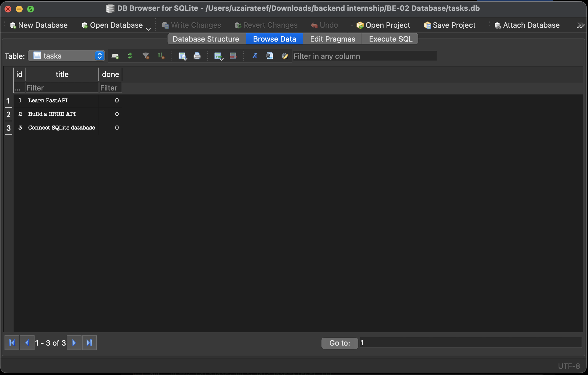

# BE-02: Connecting the CRUD API to SQLite

**Track:** Backend AI Engineering  
**Phase:** Foundations  
**Assignment:** BE-02 — Connecting to the Database  
**Technology:** Python, FastAPI, SQLite

## Overview

This project extends BE-01 by replacing in-memory task storage with a persistent SQLite database. The API provides CRUD (Create, Read, Update, Delete) operations while storing task records in a local database file.

SQLite was chosen because it is lightweight, requires no separate database server, and stores data in a single file. The database and table are initialized automatically when the application starts.

## Architecture

```text
HTTP Client
    |
    v
FastAPI Application
    |
    v
SQLite Database
    |
    v
tasks.db
```

The API layer handles HTTP requests and responses, while SQLite stores task records persistently.

## Project Structure

```text
BE-02 Database/
├── main.py
├── README.md
├── .gitignore
├── tasks.db
└── docs/
    └── database-viewer.png
```

**Note:** `tasks.db` is generated locally and excluded from Git. A fresh clone automatically creates its database when the application starts.

## Requirements

- Python 3.10 or later
- FastAPI
- Uvicorn
- SQLite, provided by Python's built-in `sqlite3` module

No separate SQLite server or database driver installation is required.

## Setup and Installation

### 1. Clone the repository

```bash
git clone https://github.com/uzairrateef-rgb/backend-internship.git
cd backend-internship
```

### 2. Create a virtual environment

Run these commands from the repository root:

```bash
python3 -m venv .venv
source .venv/bin/activate
python -m pip install -r requirements.txt
```

On Windows, activate the environment using:

```powershell
.venv\Scripts\activate
```

### 3. Start the application

From the repository root:

```bash
python -m uvicorn "main:app" --app-dir "BE-02 Database" --reload
```

The application will create `BE-02 Database/tasks.db`, create the `tasks` table if necessary, and insert three example tasks when the table is empty.

### 4. Open the API documentation

- Interactive Swagger UI: http://127.0.0.1:8000/docs
- Root endpoint: http://127.0.0.1:8000/
- Health endpoint: http://127.0.0.1:8000/health

## Database Schema

The `tasks` table contains the following columns:

| Column | Type | Description |
|---|---|---|
| `id` | INTEGER | Primary key identifying each task |
| `title` | TEXT | Task title |
| `done` | INTEGER | Completion status: `0` or `1` |

The `id` column is an integer primary key. The `done` column is constrained to accept only `0` or `1`, representing false and true respectively.

## API Endpoints

| Method | Endpoint | Description | Success |
|---|---|---|---|
| GET | `/` | API information | 200 |
| GET | `/health` | Health check | 200 |
| GET | `/tasks` | List all tasks | 200 |
| GET | `/tasks/{task_id}` | Retrieve one task | 200 |
| POST | `/tasks` | Create a task | 201 |
| PUT | `/tasks/{task_id}` | Update a task | 200 |
| DELETE | `/tasks/{task_id}` | Delete a task | 204 |

Unknown task IDs return `404`. Invalid task creation or update requests return `400`.

### Example: Create a task

```bash
curl -i -X POST http://127.0.0.1:8000/tasks \
  -H "Content-Type: application/json" \
  -d '{"title":"Learn SQLite","done":false}'
```

### Example: List tasks

```bash
curl http://127.0.0.1:8000/tasks
```

### Example: Update a task

```bash
curl -i -X PUT http://127.0.0.1:8000/tasks/1 \
  -H "Content-Type: application/json" \
  -d '{"done":true}'
```

### Example: Delete a task

```bash
curl -i -X DELETE http://127.0.0.1:8000/tasks/1
```

## SQL Examples

SQLite can be inspected using the SQLite command-line tool or DB Browser for SQLite.

List every task:

```sql
SELECT * FROM tasks;
```

Show completed tasks:

```sql
SELECT * FROM tasks WHERE done = 1;
```

Count all tasks:

```sql
SELECT COUNT(*) FROM tasks;
```

Mark all tasks as completed:

```sql
UPDATE tasks SET done = 1;
```

Delete completed tasks:

```sql
DELETE FROM tasks WHERE done = 1;
```

Database changes are reflected immediately by subsequent API requests because the API reads directly from SQLite.

## Database Screenshot

The screenshot below shows the `tasks` table and its stored records in DB Browser for SQLite.



## Persistence and Initialization

The database file is stored at:

`BE-02 Database/tasks.db`

The application creates the database and table automatically. Three example tasks are inserted only when the table is empty. Existing records persist across application restarts because the data is stored in SQLite rather than in application memory.

The database file is intentionally excluded from version control. Each installation maintains its own local database.

## Implementation Notes

- Database access uses Python's built-in `sqlite3` library.
- SQL statements use parameterized values for user-supplied data.
- Database connections are closed after use.
- Task records are serialized into JSON-compatible responses.
- Database initialization runs during application startup.

## Learning Outcomes

This assignment demonstrates how to:

- Connect a FastAPI application to SQLite.
- Create tables and seed initial records automatically.
- Implement CRUD operations using SQL.
- Preserve data across server restarts.
- Validate requests and handle missing records.
- Inspect and modify database records using SQL.

---

**Repository:** [backend-internship](https://github.com/uzairrateef-rgb/backend-internship)  
**Assignment:** BE-02 — Connecting to the Database
