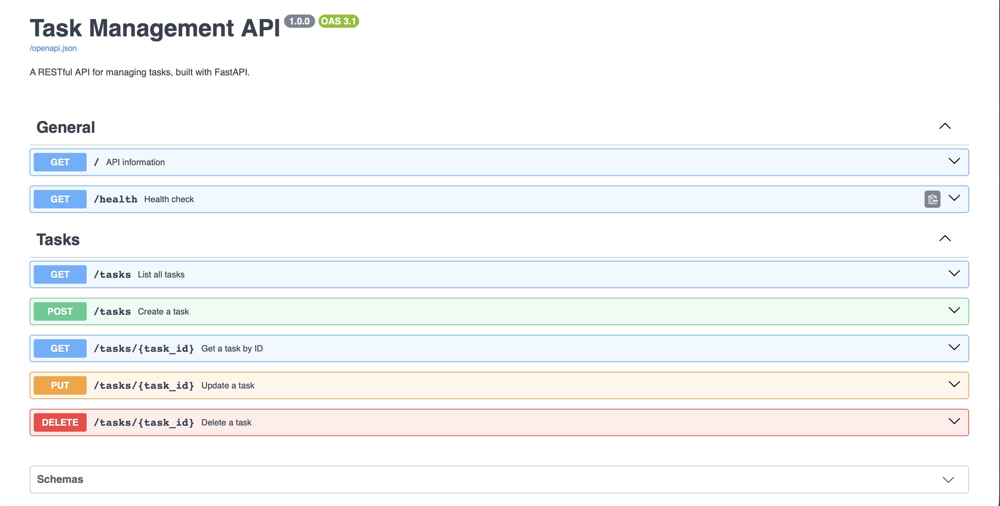
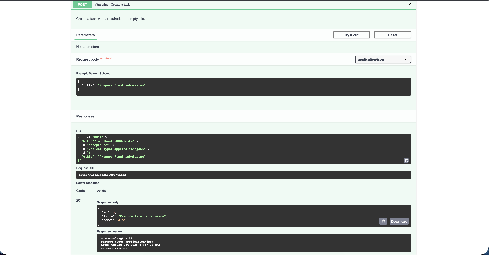

# Task Management API

A RESTful task management API built with Python and FastAPI for the Backend AI Engineering internship assignment (BE-01).

## Features

- Create, read, update, and delete tasks.
- Validate request bodies.
- Return appropriate HTTP status codes and JSON errors.
- Explore the API using interactive Swagger UI.
- Store tasks in memory without a database.

## Technology Stack

- Python 3.10+
- FastAPI
- Uvicorn

## Installation

Clone the repository:

    git clone https://github.com/uzairateef-rgb/backend-internship.git
    cd backend-internship

Create and activate a virtual environment:

    python3 -m venv .venv
    source .venv/bin/activate

On Windows, activate with:

    .venv\Scripts\Activate.ps1

Install dependencies:

    python -m pip install -r requirements.txt

## Run the API

    python -m uvicorn main:app --reload --port 8000

API base URL: http://localhost:8000

Swagger UI: http://localhost:8000/docs

Health check: http://localhost:8000/health

## Endpoints

| Method | Endpoint | Description | Success |
|---|---|---|---|
| GET | / | API information | 200 |
| GET | /health | Health check | 200 |
| GET | /tasks | List all tasks | 200 |
| GET | /tasks/{task_id} | Retrieve one task | 200 |
| POST | /tasks | Create a task | 201 |
| PUT | /tasks/{task_id} | Update a task | 200 |
| DELETE | /tasks/{task_id} | Delete a task | 204 |

## Task Example

    {
      "id": 1,
      "title": "Complete backend assignment",
      "done": false
    }

## Create a Task

Run this command while the server is running:

    curl -i -X POST http://localhost:8000/tasks -H "Content-Type: application/json" -d '{"title":"Buy milk"}'

A successful request returns 201 Created and the new task as JSON.

## Error Handling

| Status | Meaning |
|---|---|
| 400 | Invalid request body |
| 404 | Task ID not found |
| 422 | Invalid path parameter, such as a non-integer task ID |

## Swagger Screenshots

Screenshots will be stored in the docs directory. They will be added here once saved.

## Design Decisions and Limitations

Tasks are stored in an in-memory Python list. They reset to the three example tasks whenever the server restarts. This is intentional for the assignment; no database is required.

The API does not include authentication or multi-user support. It is an educational project rather than a production deployment.

## License

Created for educational purposes as part of the Backend AI Engineering internship assignment.

## Swagger UI Screenshots

### API Overview

### Request Body Documentation

